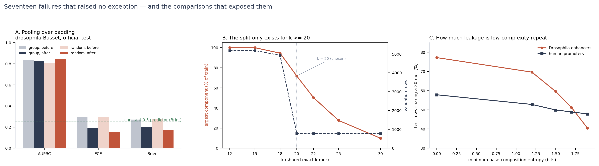

# What this repository is actually about

The pipeline ran end to end and produced plausible numbers **before any of the
problems below were found**.  That is the interesting part: a pipeline that runs
is not a pipeline that is correct, and for a project whose entire output is a
number, the only way to trust the number is to attack it.

This page is the short version — three detectors, seventeen failures, and what each
one changed.  The long version, with root causes and verification, is in
[DEVLOG.md](DEVLOG.md).

---

## Three detectors

None of the failures below raised an exception, and none of them produced an
implausible number.  They were caught by three cheap habits.

### 1. Make two independent measurements disagree

A single number cannot look wrong.  Two numbers that cannot both be true can.

| what disagreed | what it exposed |
|---|---|
| leak audit said 99.9% of test rows share a 20-mer with train, **and** the homology-grouped split shares 0% by construction | the audit was measuring its own bug: the k-mer sentinel was `4**31 + row_index`, so probing one row at a time made every row "row 0" (E2) |
| the tensor is 34.6% padding, yet the scores look ordinary | global pooling was averaging over the padding, and BatchNorm had turned the padding into a non-zero constant (P1) |
| the loss curve looked healthy | the LR trace never left the warmup: 30 of 5,400 schedule steps were ever consumed (T1) |

### 2. Test invariants, not outputs

The same 120 bp sequence, padded to 160 or to 520, must receive the same score.
It did not (max difference 0.0059).  It does now (0.000000), and the assertion
lives in `tests/test_core.py::test_padding_invariance` — it fails on the old code.

An invariant is a property you can write down in one line and check forever.  A
threshold you eyeballed is neither.

### 3. Prefer paired perturbations when the instrument is dirty

The official test set is contaminated (~59% of enhancer rows share a 20-mer with
training), so it cannot rank models finely.  But perturbing the **input** while
keeping the model, labels and test rows fixed means the contamination enters both
readings identically and cancels in the difference.  That is how these survive:

- destroy base order, keep composition → enhancer AUPRC falls to 60%
- circular-shift by one random offset → promoters keep 99.2% (architecture), enhancers 77%
- keep the first 500 bp only → AUPRC drops 12 points

And one rule on top: **any constant that carries a conclusion gets swept and
mechanism-checked.**  `k = 20` was swept (E4): it turns out to be the smallest
threshold at which the grouped split still leaves anything to hold out, and the
giant component is chained together by low-complexity repeats rather than by
homology.

---

## Seventeen failures, and the number each one moved

| ID | what was wrong | what it changed |
|---|---|---|
| P2 | train and test tensors had different widths (3237 vs 3061) | test gap **−0.0269 → +0.0217** (the sign was wrong) |
| P1 | global pooling averaged over padding | ECE **0.295 → 0.191**, Brier **0.270** (worse than a constant) **→ 0.197**; random-split AUPRC **0.805 → 0.847** |
| E1 | a constant predictor reported AUROC 0.5 | AUROC **0.5 (false) → nan** (undefined) |
| E2 | the leak audit measured its own sentinel bug | leak **99.9% → 77.2%** (enhancers) / **54.8%** (promoters) |
| E3 | the reported F1 used a threshold tuned on the test predictions | best F1 **0.83 (oracle) → val-tuned**, 1–3 points lower |
| E4 | the `k = 20` "same family" threshold was never validated | leak **77.2% → 59.5%** after removing low-complexity k-mers |
| E5 | the size of the validation set was decided by the shuffle | val **34.6% → 15.0%** of the rows (promoters), **778 → 778** rows but 3.5× spread removed (Drosophila) |
| E6 | every comparison rested on a single seed | between-seed spread **1.1 AUPRC points** (promoters) — the same size as the differences the table was ranking; retraining on the fixed split flipped the winner (Basset now **0.9324 ± 0.0114** vs **0.9414** for the 5-mer baseline) |
| T1 | the LR schedule was defined in steps but stepped per epoch | LR reached **29% of `--lr`** → full 5e-4 → 1e-3 → 0 |
| T2 | `LambdaLR` construction evaluated `lr_lambda(0)` | epoch 1 ran at **lr = 0** → 5e-4 |
| T3 | early stopping fired during the warmup plateau | runs ended at **epoch 19/30** → full schedule |
| N1 | `--no-rc-augment` overwrote the augmented run's directory | one ablation's results **disappeared** → recovered and re-tagged |
| M1 | the transformer head was `d_model` wide, not `2·d_model` | transformer **crashed** → trains |
| A1 | in-silico mutagenesis ran in probability space | every variant **+0.0000** → logit-space deltas |
| A2 | attribution outputs landed in the repository root | stray files → `reports/` |
| A3 | receptive field documented as 215 bp | **215 → 294 bp**, confirmed by backprop |
| D1 | the Chinese README was destroyed by a PowerShell encoding round-trip | **326 characters → `?`**, no git history → rebuilt, UTF-8-only policy since |

---

## Timeline

| stage | commit | what became true |
|---|---|---|
| first version | `8548ec9` | the pipeline ran, produced plausible numbers, and was wrong in ways listed above |
| padding audit | `674b6e1` | P1/P2/E3 fixed, Drosophila retrained, probes re-measured |
| threshold audit | `0a4107f` | `k` swept and stress-tested; the leak figure restated as a range, not a point |
| split audit | `3b7dec6` | the validation set stopped depending on a shuffle (E5); size now equals the request at every threshold |
| effect audit | *(this commit)* | every `group` row retrained on the fixed split and, where it mattered, with three seeds (E6); the promoter ranking is now reported as indistinguishable |

---

## What this lets me claim — and what it does not

**Claimable.** On this benchmark, promoter AUPRC is largely explained by base
composition: a 1,024-feature 5-mer logistic regression reaches **0.9414** while the
Basset CNN averages **0.9324 ± 0.0114** over three seeds — the CNN does not beat it,
and 82–89% of promoter AUPRC survives destroying base order entirely.  Enhancer
models are different: 60% survives, circular shift costs them 23 points, and the
CNN is **+12.4 points** ahead of the same linear baseline.  The official test set is
contaminated: 77% (enhancer) and 55% (promoter) of test rows share an exact 20-mer
with training, falling to 51%/48% after masking low-complexity windows.

**Not claimable.** Any absolute generalisation number.  The contaminated test set
cannot measure it, and re-clustering only the training split cannot repair it —
that requires re-partitioning the train ∪ test union by family, which is the next
experiment, not a result in hand.  Every number here should be read as an upper
bound with its contamination attached.

**Not a contribution.** No new architecture, no SOTA, no new biology.  The
contribution is the audit: instruments, and the failure list.
